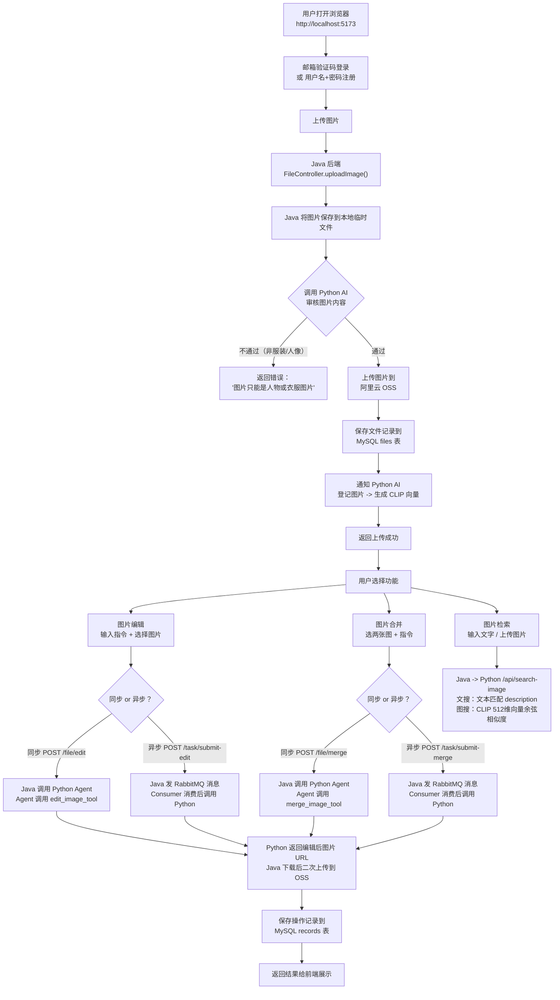
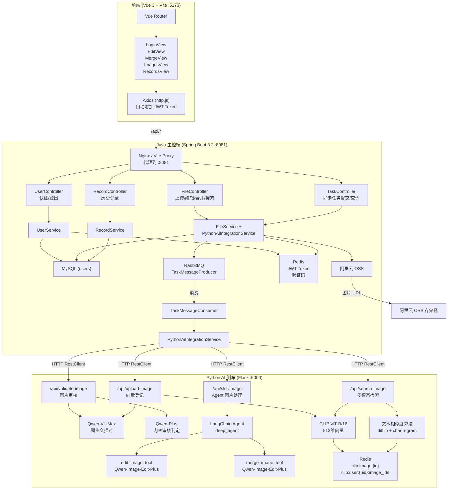
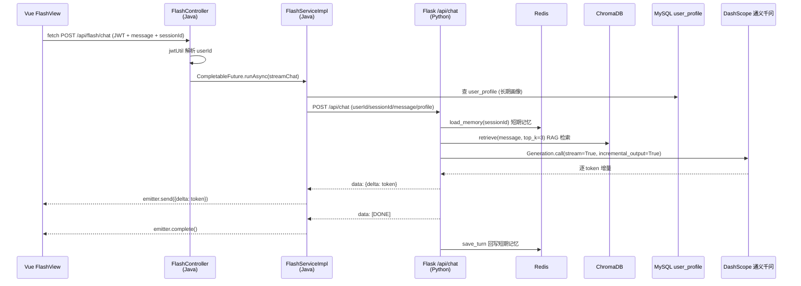
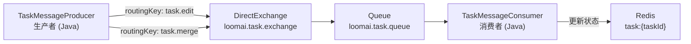

# 项目技术架构分析文档 — LoomAI

> 分析日期：2026-08-08
> 基于代码仓库真实实现分析，非概念性描述

---

## 1. 项目整体介绍

### 1.1 业务问题

LoomAI 是一个**智能服装搭配与多模态检索平台**。用户上传服装/人像图片后，系统通过 AI 实现：

- 图片合规性自动审核（仅允许服装、穿搭、人像类图片）
- 文搜图 / 图搜图（用自然语言或图片查找相似穿搭）
- AI 图片编辑（换背景、去水印、风格调整等）
- AI 图片合并（两张服装图合成为一张搭配图）
- Flash 实时穿搭对话（纯文字，SSE 流式输出，结合 RAG 知识库与用户偏好给出搭配建议）

### 1.2 用户完整使用流程



---

## 2. 系统整体架构

### 2.1 架构类型

本项目是 **Java + Python 异构混合架构**，前端 Vue 3 完全独立，属于**前后端分离**。

不属于微服务。Java 和 Python 是**主从关系**（Java 为主控端，Python 为 AI 能力侧车/Sidecar），所有用户请求必须经过 Java 端鉴权后才会调用 Python。

### 2.2 职责划分

| 层 | 技术 | 职责 |
|----|------|------|
| Java Spring Boot | 主控端 | 用户认证、权限校验、文件上传、OSS 存储、业务编排、RabbitMQ 消息、调用 Python |
| Python Flask | AI 侧车 | 图片审核（Qwen-VL）、CLIP 向量化、文搜图/图搜图、Agent 工具调用、图像编辑/合并 |
| Vue 3 + Vite | 前端 | 页面渲染、用户交互、Token 管理 |

### 2.3 为什么拆成 Java + Python？

- AI 生态集中在 Python（LangChain、Transformers、CLIP、DashScope SDK），Java 没有同等成熟的 AI 工具链
- Java 负责稳定业务层（鉴权、事务、数据库），Python 负责 AI 推理
- 通过 HTTP（RestClient ↔ Flask）跨语言通信，松耦合

### 2.4 系统架构图



### 2.5 Flash 实时对话扩展架构（新增）

Flash 是本项目在原有图片功能之外新增的**实时穿搭对话助手**，复用「前端 → Java 鉴权 → Python AI」的同构链路，但传输协议由普通 HTTP 改为 **SSE（Server-Sent Events）** 流式：



**关键点**：

- **SSE 三层透传**：Python 用 Flask `stream_with_context` + `Response(mimetype="text/event-stream")`；Java 用 `SseEmitter`（spring-webmvc 内置）+ `HttpClient.BodyHandlers.ofLines()`（JDK 内置）逐行转发；前端用原生 `fetch` + `ReadableStream`（`EventSource` 带不了 JWT 头）。
- **零新依赖**：Java 侧 SSE 能力全部来自 Spring MVC 与 JDK，无需新增 pom 依赖。
- **记忆分层**：短期记忆在 Python（Redis + 摘要），长期画像在 Java（MySQL `user_profile`），通过请求体 `profile` 字段传给 Python，Python 不碰 MySQL。

---

## 3. 技术栈分析

### 3.1 Java 端

| 技术 | 作用 | 为什么选择 | 使用位置 | 代码文件 |
|------|------|-----------|----------|----------|
| Spring Boot 3.2 | 应用框架 | 生态成熟，自动配置 | 项目启动 | `AIWearApplication.java` |
| Spring MVC | REST API | Spring Boot 内置 | Controller 层 | `FileController.java` 等 |
| MyBatis-Plus 3.5.7 | ORM | 比 MyBatis 少写 SQL，比 JPA 灵活 | 数据访问层 | `FileMapper.java`, `UserMapper.java`, `RecordMapper.java` |
| Spring Data Redis | Redis 操作 | Spring 生态统一抽象 | JWT 缓存、验证码、任务状态 | `JwtUtil.java`, `VerificationCodeService.java`, `FileServiceImpl.java` |
| Spring AMQP (RabbitMQ) | 消息队列 | 异步解耦图片编辑/合并 | 异步任务 | `RabbitMqConfig.java`, `TaskMessageProducer.java`, `TaskMessageConsumer.java` |
| Spring Mail | 邮件发送 | QQ 邮箱 SMTP 发验证码 | 验证码发送 | `EmailService.java` |
| Spring Security Crypto | 密码加密 | BCrypt 单向加密 | 用户密码存储 | `UserServiceImpl.java` |
| JJWT 0.11.5 | JWT 令牌 | 无状态认证 | 用户登录态 | `JwtUtil.java` |
| Aliyun OSS SDK 3.17.4 | 对象存储 | 图片持久化存储 | 图片上传 | `FileServiceImpl.java`, `PythonAiIntegrationServiceImpl.java` |
| Spring AOP | 切面编程 | 统一 API 日志记录 | 日志拦截 | `ApiLogAspect.java` |
| Lombok | 代码简化 | 减少样板代码 | 所有实体/DTO | 全项目使用 |
| Spring Validation | 参数校验 | Controller 层入参自动校验 | 请求 DTO | `EditImageRequest.java` 等 |
| Spring MVC SseEmitter | SSE 流式响应 | 服务端推送，零新依赖 | Flash 实时对话 | `FlashController.java` |
| java.net.http.HttpClient | 跨语言 SSE 转发 | JDK 17 内置，读 Python 流 | Flash 流式转发 | `FlashServiceImpl.java` |

### 3.2 Python 端

| 技术 | 作用 | 为什么选择 | 使用位置 | 代码文件 |
|------|------|-----------|----------|----------|
| Flask 3.1.3 | Web 框架 | 轻量级，适合 AI 服务 | 所有 API 路由 | `server.py` |
| Flask-CORS | 跨域支持 | 允许跨域请求 | 全局 | `server.py` |
| LangChain 1.2.7 | LLM 应用框架 | 统一的模型调用接口 | 图片描述、审核、Agent | `server.py` |
| DeepAgents 0.7.5 | Agent 框架 | 基于 LangGraph 的 Agent 编排 | Agent 初始化与执行 | `server.py` |
| Transformers 5.0 | 模型加载 | 加载本地 CLIP 模型 | CLIP 向量化 | `server.py` |
| PyTorch 2.10 | 深度学习框架 | CLIP 模型推理 | CLIP embedding | `server.py` |
| DashScope 1.25.9 | 阿里云 AI SDK | 调用通义千问系列模型 | 图片编辑、合并 | `server.py` |
| Redis 7.3.0 | 缓存客户端 | CLIP 向量存储 | 向量读写 | `server.py` |
| Pillow | 图片处理 | 图片格式转换 | 图片预处理 | `server.py` |
| ChromaDB 1.5.9 | 向量数据库 | 本地持久化、轻量易用 | RAG 知识库检索 | `rag.py` |
| langchain-classic 1.0.1 | 记忆组件 | 提供 `ConversationSummaryMemory` | 短期记忆摘要 | `memory.py` |
| DashScope TextEmbedding | 文本向量化 | text-embedding-v3，1024 维 | RAG 检索 | `rag.py` |

### 3.3 AI 模型

| 模型 | 提供商 | 作用 | 调用方式 |
|------|--------|------|----------|
| Qwen-VL-Max | 通义千问 | 图片内容描述生成（图生文） | LangChain `ChatTongyi` |
| Qwen-Plus | 通义千问 | 内容审核判定 + Agent LLM | LangChain `ChatTongyi` |
| Qwen-Image-Edit-Plus | 通义千问 | 图片编辑/合并 | DashScope `MultiModalConversation` |
| CLIP ViT-B/16 (本地) | OpenAI | 图片 → 512维向量 | `transformers.CLIPModel` |
| text-embedding-v3 | 通义千问 | 文本 → 1024 维向量（RAG） | DashScope `TextEmbedding` |

### 3.4 存储

| 存储 | 作用 | 具体数据 |
|------|------|----------|
| MySQL 8.0 | 业务数据 | users、files、records、user_profile 表 |
| Redis 7 | 缓存 | JWT Token、验证码、CLIP 向量、任务状态、短期记忆摘要 |
| ChromaDB 1.5.9 | 向量存储 | 服装知识库向量（fashion_knowledge） |
| Aliyun OSS | 图片存储 | 用户上传图和 AI 生成结果图 |

### 3.5 前端

| 技术 | 作用 |
|------|------|
| Vue 3 | UI 框架 |
| Vite 7 | 构建工具 |
| Vue Router 4 | 路由管理 |
| Pinia | 状态管理 |
| Element Plus | UI 组件库 |
| Axios | HTTP 请求 |

> Flash 实时对话未使用 Axios（浏览器端 axios 不支持读流式响应体），改用原生 `fetch` + `ReadableStream`。

---

## 4. 按业务功能分析

### 功能 1：用户认证

**业务目的**：支持邮箱验证码登录（新用户自动注册）和用户名+密码登录（新用户自动注册），JWT Token 认证。

**调用流程**：
```
POST /api/user/send-code → 发送验证码邮件
POST /api/user/auth    → 统一认证（邮箱+验证码 or 用户名+密码）
POST /api/user/logout  → 登出（删除 Redis 中 Token）
```

**涉及技术**：Spring Mail（QQ SMTP）、BCrypt 密码加密、JWT、Redis

**Controller**: `UserController.java:28-55`

```java
// 发送邮箱验证码
@PostMapping("/send-code")
public Result<SendVerificationCodeResponse> sendVerificationCode(
    @RequestBody @Valid SendVerificationCodeRequest request) {
    boolean success = userService.sendVerificationCode(request);
    ...
}

// 统一认证接口（注册+登录）
@PostMapping("/auth")
public Result<AuthResponse> auth(@RequestBody @Valid AuthRequest request) {
    return Result.success("操作成功", userService.auth(request));
}
```

**Service**：`UserServiceImpl.java:56-109`

核心认证逻辑：
```java
public AuthResponse auth(AuthRequest request) {
    String account = request.getAccount();
    boolean isEmail = account.contains("@");  // 含@ = 邮箱方式

    User user = userMapper.selectOne(queryWrapper);

    if (isEmail) {
        // 验证码验证 → 新用户自动注册
        if (!verificationCodeService.verifyCode(account, code)) {
            throw new RuntimeException("验证码错误 或 已过期");
        }
        if (user == null) {
            user = new User();
            user.setUsername(account);
            user.setEmail(account);
            userMapper.insert(user);
        }
    } else {
        // 用户名+密码 → BCrypt 校验
        if (user == null) {
            user = new User();
            user.setUsername(account);
            user.setPasswordhash(passwordEncoder.encode(request.getPassword()));
            userMapper.insert(user);
        } else {
            if (!passwordEncoder.matches(request.getPassword(), user.getPasswordhash())) {
                throw new RuntimeException("用户名或密码错误");
            }
        }
    }
    return createResponse(user);  // 生成 JWT Token
}
```

**JWT 存储**：`JwtUtil.java:45-76` — Token 生成后存入 Redis `jwt:user:{userId}`，同用户多次登录复用 Token。

**验证码存储**：`VerificationCodeService.java` — 存 Redis `verification:code:{email}`，有效期 5 分钟。

---

### 功能 2：图片上传 + AI 审核

**为什么需要图片审核？** 平台只允许服装/穿搭/人像类图片，需要自动过滤不合规内容（如风景照、截图、违规图）。

**调用流程**：
```
用户上传图片
→ FileController.uploadImage()
→ FileServiceImpl.uploadImage()
→ PythonAiIntegrationService.validateImage(tempFilePath)
→ Flask /api/validate-image
→ Qwen-VL-Max 生成图片描述（describe_image）
→ Qwen-Plus 做内容审核判定（validate_image）
→ 返回 allow=true/false
→ 通过：上传 OSS → 保存 MySQL → 调用 /api/upload-image 登记 CLIP 向量
→ 不通过：抛异常
```

**审核模型调用链**：`server.py:85-143`

```python
# 第一步：Qwen-VL-Max 图生文
def describe_image(image_data: bytes) -> str:
    data_uri = process_image(image_data)
    human_content = [
        {"image": data_uri},
        {"text": "用一句话简要地概括这张图片的内容，并给出3到5个关键词..."}
    ]
    vl_llm = ChatTongyi(model_name="qwen-vl-max", temperature=0.0, ...)
    resp = vl_llm.invoke([HumanMessage(content=human_content)])
    return resp.content[0]['text']

# 第二步：Qwen-Plus 审核判定
def validate_image(image_desc: str) -> bool:
    prompt = ChatPromptTemplate.from_messages([
        ("system", "你是一个图片审核助手，当前的业务只允许两种图片："
         "1) 衣服/服装/穿搭相关; 2) 人物人像..."  // Prompt 写死在这里
        ),
        ("human", f"图片文字描述: {image_desc}")
    ])
    llm = ChatTongyi(model_name="qwen-plus", temperature=0.7, ...)
    resp = llm.invoke(prompt.format_messages())
    return resp.content.startswith("是")
```

**Service**：`PythonAiIntegrationServiceImpl.java:114-136`

```java
public boolean validateImage(Path filePath) {
    MultiValueMap<String, Object> body = new LinkedMultiValueMap<>();
    body.add("file", new FileSystemResource(filePath.toFile()));
    ResponseEntity<String> response = restClient.post()
            .uri(VALIDATE_IMAGE_PATH)  // "/api/validate-image"
            .body(body).retrieve().toEntity(String.class);
    return objectMapper.readTree(response.getBody())
            .path("allow").asBoolean(false);
}
```

---

### 功能 3：服装图文检索（多模态搜索）

**CLIP 模型作用**：将图片转换为 512 维语义向量，同语义的图向量距离近（如"红色连衣裙"和任何红色连衣裙图片向量相似度高）。

**向量存储**：Redis，Key 格式 `clip:image:{imageId}`，Value 为 JSON：
```json
{
  "userId": 10000001,
  "imageId": "abc123...",
  "ossUrl": "https://...",
  "description": "一件红色连衣裙，关键词：红色, 连衣裙, 时尚",
  "embedding512": [0.123456, -0.234567, ...]  // 512维float数组
}
```
同时维护用户索引 `clip:user:{userId}:image_ids`（Redis Set）。

**图搜图流程**：`server.py:431-448`
```python
# 1. 上传的图片 → CLIP 512维向量
query_vec = clip_image_to_512d(image_data)

# 2. 遍历该用户所有已登记图片的向量
for obj in items:
    emb = obj.get("embedding512")
    sim = cosine_similarity_512(query_vec, emb)  # 余弦相似度
    if sim >= 0.7:   # 阈值 0.7
        results.append({"filePath": obj.get("ossUrl"), "similarity": sim})
```

**文搜图流程**：`server.py:450-463`
```python
# 不用 CLIP 文本编码器，而是字符串相似度
for obj in items:
    desc = obj.get("description")
    sim = text_similarity(str(query), str(desc))
    if sim >= 0.01:  # 阈值极低，几乎全返回
        results.append(...)
```

**注意**：文搜图的"文"并未使用 CLIP 的文本编码器（`clip-vit-base-patch16` 模型其实支持文本编码），而是用了 `difflib.SequenceMatcher` + `char n-gram Jaccard` 做字符串相似度匹配。这是一种简化实现，精度不如 CLIP 文本编码。

**Service**：`PythonAiIntegrationServiceImpl.java:139-191`

```java
public List<SearchImageResponse> search(Long userId, SearchImageRequest searchImageRequest) {
    MultiValueMap<String, Object> body = new LinkedMultiValueMap<>();
    body.add("userId", userId);
    if (query != null) body.add("query", query);
    if (file != null) body.add("file", fileResource);
    // POST /api/search-image
    ResponseEntity<String> response = restClient.post()
            .uri(SEARCH_IMAGE_PATH).body(body).retrieve().toEntity(String.class);
    // 解析返回的 filePath 列表
}
```

---

### 功能 4：Agent 智能搭配（图片编辑 + 合并）

**LangChain Agent 初始化**：`server.py:564-580`

```python
from deepagents import create_deep_agent
from langchain_core.tools import tool

llm = ChatTongyi(model_name="qwen-plus", temperature=0.1, dashscope_api_key=API_KEY)

@tool
def edit_image_tool(image_path: str, instruction: str) -> str:
    """编辑单张图片，调用 Qwen-Image-Edit-Plus"""

@tool
def merge_image_tool(image_path1: str, image_path2: str, instruction: str) -> str:
    """合并两张图片，调用 Qwen-Image-Edit-Plus"""

deep_agent = create_deep_agent(
    model=llm,
    tools=[edit_image_tool, merge_image_tool],
    skills=["/skills/"],
    system_prompt="你是一个智能图片处理助手..."
)
```

**Tool 注册方式**：使用 LangChain `@tool` 装饰器，函数名即工具名，docstring 即工具描述。LLM 通过函数签名和 docstring 理解工具能力，自主决定调用哪个。

**LLM 如何决定调用哪个 Tool**：DeepAgents 基于 LangGraph 的 ReAct 模式 — LLM 收到用户指令后，根据 system_prompt 和 tool 描述做 reasoning，输出 tool_call（包含函数名和参数），框架执行后把结果返回给 LLM，LLM 再做最终响应。

**完整调用链**（以图片编辑为例）：

```
前端 EditView.vue → POST /api/file/edit
→ FileController.edit()
→ FileServiceImpl.edit()
  ├── 鉴权：用户只能编辑自己上传的图片（比对 ossUrl）
  └── PythonAiIntegrationService.edit()
        ├── downloadToTempFile(ossUrl) → 下载 OSS 图片到本地临时文件
        ├── POST /api/skill/image {file, instruction}
        │     └── Flask skill_image()
        │           ├── 将图片保存到临时目录
        │           ├── invoke_agent() → deep_agent.invoke()
        │           │     └── LLM 推理 → 调用 edit_image_tool()
        │           │           └── DashScope qwen-image-edit-plus
        │           │                 → 返回编辑后的临时图片 URL
        │           └── 返回 {"success": true, "url": "..."}
        ├── downloadToTempFile(pythonUrl) → 下载 AI 返回的临时图片
        ├── uploadEditedFileToOss() → 二次上传到 OSS 持久化
        └── 清理所有临时文件 (finally)
```

**关键代码**：`server.py:606-643`
```python
def skill_image() -> str:
    instruction = request.form.get("instruction")
    tmp_dir = tempfile.gettempdir()
    prompt_lines = [
        "你必须调用一个工具，并且只输出 JSON格式",
        f"instruction: {instruction}"
    ]
    if "file1" in request.files and "file2" in request.files:
        # 合并模式
        p1 = save_temp(request.files["file1"])
        p2 = save_temp(request.files["file2"])
        prompt_lines.append(f"image_path1: {p1}")
        prompt_lines.append(f"image_path2: {p2}")
    else:
        # 编辑模式
        p = save_temp(request.files["file"])
        prompt_lines.append(f"image_path: {p}")
    out = invoke_agent("\n".join(prompt_lines))
    return out.get("url", "")
```

---

### 功能 5：RabbitMQ 异步任务

**为什么增加 RabbitMQ？** 图片编辑/合并调用 AI 模型耗时长（可能 30s~5min），同步阻塞用户体验差。异步化后用户提交任务立即返回 taskId，通过轮询查询结果。

**加入 MQ 之前的缺陷**：
- 同步调用 `/api/file/edit`，用户等待时间 = 下载 OSS 图片 + AI 模型推理 + 上传结果图
- 高峰期大量请求会阻塞 Tomcat 线程池

**加入 MQ 之后**：
- 同步接口仍保留（`POST /api/file/edit`）
- 新增异步接口（`POST /api/task/submit-edit`），立即返回 `{taskId, "PENDING"}`

**MQ 架构**：



**RabbitMQ 配置**：`RabbitMqConfig.java:19-42`
```java
public static final String TASK_EXCHANGE = "loomai.task.exchange";
public static final String TASK_QUEUE    = "loomai.task.queue";
public static final String ROUTING_KEY_EDIT  = "task.edit";
public static final String ROUTING_KEY_MERGE = "task.merge";

@Bean public DirectExchange taskExchange() { ... }  // 持久化，非自动删除
@Bean public Queue taskQueue() { ... }               // 持久化队列
@Bean public Binding editBinding() { ... }           // task.edit → queue
@Bean public Binding mergeBinding() { ... }          // task.merge → queue
```

**消息结构**：`TaskMessage.java`
```java
public class TaskMessage {
    private String taskId;           // UUID
    private Long userId;
    private String type;             // "EDIT" or "MERGE"
    private Map<String, String> params;  // image/instruction or image1/image2/instruction
}
```

**生产者**：`TaskMessageProducer.java:17-33`
```java
public void sendEditTask(TaskMessage message) {
    rabbitTemplate.convertAndSend(
        TASK_EXCHANGE, ROUTING_KEY_EDIT, message);  // Jackson2Json 序列化
}
```

**消费者**：`TaskMessageConsumer.java:36-57`
```java
@RabbitListener(queues = RabbitMqConfig.TASK_QUEUE)
public void handleTask(TaskMessage message) {
    String taskId = message.getTaskId();
    try {
        updateTaskStatus(taskId, buildStatus("PROCESSING", ...));  // 写 Redis
        if ("EDIT".equals(message.getType())) {
            handleEditTask(message);   // 调 Python edit API
        } else if ("MERGE".equals(message.getType())) {
            handleMergeTask(message);  // 调 Python merge API
        }
        updateTaskStatus(taskId, buildStatus("SUCCESS", url, saveUrl, null));
    } catch (Exception e) {
        updateTaskStatus(taskId, buildStatus("FAILED", ..., e.getMessage()));
    }
}
```

**任务状态查询**：`FileServiceImpl.java:240-250`
```java
public TaskStatusResponse getTaskStatus(String taskId) {
    String json = stringRedisTemplate.opsForValue().get("task:" + taskId);
    if (json == null) throw new RuntimeException("任务不存在或已过期");
    return objectMapper.readValue(json, TaskStatusResponse.class);
}
```
任务状态 TTL 为 1 小时。

---

### 功能 6：Flash 实时对话助手（SSE + RAG + 记忆）

**业务目的**：提供纯文字、流式输出的穿搭顾问，结合服装知识库（RAG）、用户偏好（长期画像）与会话上下文（短期记忆）给出建议。是项目从「图片处理工具」向「对话式 AI 助手」的扩展，前端为独立页面 `FlashView`，侧栏新增入口。

**整体链路**：

```
前端 FlashView ──fetch SSE──▶ FlashController ──SseEmitter──▶ FlashServiceImpl ──HttpClient.ofLines()──▶ Python /api/chat
                                                                                                          ├─ 短期记忆 Redis
                                                                                                          ├─ RAG ChromaDB 检索
                                                                                                          └─ 长期画像(Java 查好传入)
```

**调用流程**：

```
1. 前端 FlashView.vue 挂载时生成 sessionId（crypto.randomUUID，短期记忆 key）
2. fetch POST /api/flash/chat，body {message, sessionId}，带 JWT
3. Java FlashController.chat() → jwtUtil 解析 userId → new SseEmitter(300s)
4. CompletableFuture.runAsync → FlashServiceImpl.streamChat()
   a. userProfileService.getByUserId(userId) 查长期画像
   b. 组装 {userId, sessionId, message, profile:{style,color,bodyType}}
   c. HttpClient POST Python /api/chat，BodyHandlers.ofLines() 逐行读
   d. 解析 "data: {...}" → emitter.send(Map.of("delta", delta))
   e. 遇 "[DONE]" → emitter.complete()
5. Python /api/chat（server.py）
   a. ChatMemoryStore.load_memory(sessionId) 读短期记忆摘要
   b. rag.retrieve(message, top_k=3) 检索知识
   c. 拼 system_prompt = 人设 + 画像 + 知识 + 记忆摘要
   d. Generation.call(stream=True, incremental_output=True) 逐 token
   e. yield "data: {delta}\n\n"，结束后 save_turn 回写记忆
6. 前端读 ReadableStream，解析 SSE，逐 delta 拼到 assistantMsg.content（打字机）
```

**涉及技术**：SSE（`SseEmitter` / Flask `stream_with_context` / fetch `ReadableStream`）、ChromaDB、DashScope `text-embedding-v3`、Redis + `ConversationSummaryMemory`、MySQL `user_profile`

下面分别分析三个子能力：

#### 6.1 RAG（检索增强生成）

**作用**：从 `knowledge_base/` 下的服装搭配文档（色彩搭配、风格指南、体型穿搭、场合穿搭）中检索与问题最相关的片段，拼进 system prompt，让回答有据可依。

**实现**：`rag.py`（独立模块，不 import server.py）

```python
class DashScopeEmbeddingFunction(chromadb.EmbeddingFunction):
    """把文本转成 1024 维向量，供 ChromaDB 调用"""
    def __call__(self, input):
        # ChromaDB 会传入 list[str]
        if isinstance(input, str):
            input = [input]
        embeddings = []
        for text in input:
            resp = TextEmbedding.call(model="text-embedding-v3", input=text, api_key=API_KEY)
            if resp.status_code == 200:
                embeddings.append(resp.output["embeddings"][0]["embedding"])
            else:
                embeddings.append([0.0] * 1024)  # 兜底零向量，避免单条失败拖垮入库
        return embeddings

def get_collection():
    client = chromadb.PersistentClient(path=CHROMA_DIR)
    return client.get_or_create_collection(
        name="fashion_knowledge",
        embedding_function=DashScopeEmbeddingFunction(),
        metadata={"hnsw:space": "cosine"})

def ingest():   # 读 knowledge_base/*.md 按空行分段 → upsert 入库
def retrieve(query, top_k=3):  # collection.query(query_texts=[query], n_results=top_k)
```

**检索注入**（`server.py` 的 `/api/chat`）：

```python
knowledge_text = ""
try:
    knowledge = retrieve(message, top_k=3)
    knowledge_text = "\n".join(f"- {k}" for k in knowledge if k)
except Exception as e:
    print(f"RAG 检索失败: {e}")
```

**踩坑**：`DashScopeEmbeddingFunction` 必须继承 `chromadb.EmbeddingFunction`。ChromaDB 查询路径会调用 `embed_query()`（基类默认委托给 `__call__()`），若不继承基类，`retrieve()` 会抛 `'DashScopeEmbeddingFunction' object has no attribute 'embed_query'`。

#### 6.2 短期记忆（会话历史 + 摘要）

**作用**：同一 session 内多轮对话能接上下文（如先聊通勤、再问"换成约会呢"）。用摘要压缩长对话，避免历史消息无限膨胀消耗 token。

**实现**：`memory.py` 的 `ChatMemoryStore`，Redis key `chat:session:{session_id}:summary`，TTL 2 小时，集成 LangChain `ConversationSummaryMemory`（`langchain_classic.memory`）。

```python
class ChatMemoryStore:
    def load_memory(self, session_id):    # 读 Redis 摘要
    def get_history_text(self, memory):   # 取摘要文本，拼进 system prompt
    def save_turn(self, session_id, memory, user_msg, ai_msg):  # 追加本轮 + 摘要
```

**注意**：摘要只保留「概括」，会丢失对话细节，且 TTL 2 小时后自动过期（与前端 sessionId 对应，前端「新对话」会重置 sessionId）。

#### 6.3 长期记忆（用户画像）

**作用**：保存用户稳定的穿搭偏好（风格 / 颜色 / 体型），跨会话生效。第一版采用「用户显式设置」，而非自动从对话提取。

**实现**：长期画像落库在 **Java 侧**（MySQL `user_profile` 表），Python 不碰 MySQL —— Java 查好后通过请求体 `profile` 字段传入，数据边界清晰。

```java
// FlashController.java —— 画像读写接口
@GetMapping("/profile")   // 查询当前用户画像
@PostMapping("/profile")  // 保存画像 {style, color, bodyType}
```

```java
// FlashServiceImpl.java —— 查画像并传给 Python
UserProfile profile = userProfileService.getByUserId(userId);
Map<String, Object> profileMap = new LinkedHashMap<>();
profileMap.put("style", profile == null ? "" : profile.getStyle());
profileMap.put("color", profile == null ? "" : profile.getColor());
profileMap.put("bodyType", profile == null ? "" : profile.getBodyType());
body.put("profile", profileMap);
```

`user_profile` 表结构：`id` / `user_id`（unique）/ `style` / `color` / `body_type` / `updated_at`。

#### 6.4 流式输出与踩坑

**Java 逐行转发**（`FlashServiceImpl.java`）：

```java
HttpResponse<Stream<String>> response = httpClient.send(request, HttpResponse.BodyHandlers.ofLines());
try (Stream<String> lines = response.body()) {
    Iterator<String> it = lines.iterator();
    while (it.hasNext()) {
        String line = it.next();
        if (line == null || !line.startsWith("data:")) continue;
        String payload = line.substring("data:".length()).trim();
        if ("[DONE]".equals(payload)) break;
        String delta = objectMapper.readTree(payload).path("delta").asText("");
        if (!delta.isEmpty()) {
            emitter.send(Map.of("delta", delta));  // 用 JSON 包裹，避免 delta 内换行破坏 SSE 帧
        }
    }
}
emitter.complete();
```

**Python 流式生成（绕过 ChatTongyi 的 bug）**：

```python
# server.py /api/chat 的 generate() —— 直接调 DashScope，而非 llm.stream()
responses = Generation.call(
    model="qwen-plus",
    messages=[{"role": "system", "content": system_content},
              {"role": "user", "content": message}],
    result_format="message", stream=True,
    incremental_output=True, api_key=API_KEY)
for resp in responses:
    token = resp["output"]["choices"][0]["message"]["content"]
    if token:
        yield f"data: {json.dumps({'delta': token}, ensure_ascii=False)}\n\n"
```

> **踩坑**：langchain-community 0.4.1 的 `ChatTongyi.stream()` 会把增量 token 吞掉，只吐一个完整文本 chunk（其 `_stream` 每个 chunk 的 `.content` 为空，增量在 `convert_dict_to_message(is_chunk=True)` 里被丢），导致前端「等很久一次性全输出」。改为直接调 DashScope `Generation.call(stream=True, incremental_output=True)` 后逐 token 正常。

**前端读流**（`FlashView.vue` + `api.js`）：

```js
// api.js —— 不用 axios，用原生 fetch 拿 ReadableStream
const res = await fetch('/api/flash/chat', {
  method: 'POST',
  headers: { 'Content-Type': 'application/json', Authorization: `Bearer ${auth.token}` },
  body: JSON.stringify({ message, sessionId }),
})
return res.body  // ReadableStream

// FlashView.vue —— 逐段解析 SSE，拼到消息（打字机效果）
const reader = stream.getReader()
const decoder = new TextDecoder()
// buffer 按 "\n\n" 切分事件，解析 data: {delta}
```

**会话保留（前端 localStorage）**：按登录用户 `userId` 隔离存储 `flash_chat_{userId}`，挂载时恢复 `sessionId + messages`，切页面 / 刷新不丢聊天。这是「简单实现」选型，非服务端落库。

---

## 5. 数据流分析

### 完整请求追踪：图片上传 + AI 审核 + 向量登记

```
HTTP POST /api/file/upload/image
  Header: Authorization: Bearer <jwt_token>
  Body: multipart/form-data { file }

    ↓ 代码文件: FileController.java:32-35
    │ 方法: uploadImage(@RequestParam file, @RequestHeader Authorization)
    │
    ↓ FileServiceImpl.java:76-122
    │ 方法: uploadImage(MultipartFile file, String authorization)
    │
    ├─ 1. validateFile(file)
    │     └─ 校验：非空、大小限制、Content-Type 以 image/ 开头
    │
    ├─ 2. jwtUtil.parseToken(authorization)
    │     └─ 代码: JwtUtil.java:80-85
    │     └─ 从 "Bearer xxx" 中提取 token 字符串
    │
    ├─ 3. jwtUtil.getUserId(token)
    │     └─ 代码: JwtUtil.java:98-102
    │     └─ 解析 JWT Claims 获取 userId (Long)
    │
    ├─ 4. Files.createTempFile("upload-", suffix)
    │     └─ 系统临时目录创建临时文件
    │
    ├─ 5. pythonAiIntegrationService.validateImage(tempPath)
    │     └─ 代码: PythonAiIntegrationServiceImpl.java:114-136
    │     └─ POST http://127.0.0.1:5000/api/validate-image
    │         ├─ Flask: server.py:242-253  validate_image_api()
    │         ├─ describe_image(image_data)
    │         │   ├─ Qwen-VL-Max (ChatTongyi)
    │         │   └─ 返回: "一位女性穿着红色连衣裙，关键词：女性, 红色, 连衣裙, 时尚"
    │         ├─ validate_image(desc)
    │         │   ├─ Qwen-Plus (ChatTongyi)
    │         │   └─ 返回: "是" → allow=true
    │         └─ 返回 {"code":200, "allow": true}
    │     └─ 解析 response.allow → true
    │
    ├─ 6. saveToLocalFromPath(tempPath, objectKey)
    │     └─ 复制到 user.dir/uploads/images/2026/08/08/uuid.png
    │
    ├─ 7. uploadToOssFromLocal(objectKey)
    │     └─ 代码: FileServiceImpl.java:291-307
    │     └─ Aliyun OSS SDK putObject → ossUrl
    │
    ├─ 8. saveFileRecord(userId, fileName, fileSize, ossUrl)
    │     └─ MySQL INSERT INTO files (user_id, file_name, file_size, oss_url)
    │
    ├─ 9. pythonAiIntegrationService.registerUploadedImage(userId, ossUrl)
    │     └─ 代码: PythonAiIntegrationServiceImpl.java:69-111
    │     └─ POST http://127.0.0.1:5000/api/upload-image {ossUrl, userId}
    │         ├─ Flask: server.py:306-378 upload_image_api()
    │         ├─ requests.get(ossUrl) → 下载图片
    │         ├─ describe_image(image_data) → Qwen-VL-Max 生成描述
    │         ├─ clip_image_to_512d(image_data)
    │         │   ├─ CLIPModel.from_pretrained(local_dir)
    │         │   ├─ processor(images=img) → model.get_image_features()
    │         │   ├─ L2 归一化 (除以 norm)
    │         │   └─ 返回 512维 float 列表 [0.123, -0.234, ...]
    │         ├─ Redis SET clip:image:{imageId} → JSON {userId, imageId, ossUrl, description, embedding512}
    │         ├─ Redis SADD clip:user:{userId}:image_ids → imageId
    │         └─ 返回 {"success": true, "imageId": "..."}
    │
    └─ 返回 FileUploadResponse {url, fileName, fileSize}
```

### Flash 实时对话完整请求追踪（SSE）

```
HTTP POST /api/flash/chat
  Header: Authorization: Bearer <jwt_token>
  Body: {"message": "帮我推荐通勤穿搭", "sessionId": "uuid"}

    ↓ FlashController.java: chat()
    │  jwtUtil.getUserId(parseToken(authorization)) → userId
    │  new SseEmitter(300_000L) + CompletableFuture.runAsync(streamChat)
    │
    ↓ FlashServiceImpl.java: streamChat()
    │  ├─ userProfileService.getByUserId(userId) → user_profile 表
    │  ├─ body = {userId, sessionId, message, profile:{style,color,bodyType}}
    │  └─ HttpClient POST http://127.0.0.1:5000/api/chat (BodyHandlers.ofLines())
    │
    ↓ Flask server.py: chat_api()
    │  ├─ ChatMemoryStore.load_memory(sessionId) → Redis chat:session:{id}:summary
    │  ├─ retrieve(message, top_k=3) → ChromaDB fashion_knowledge 检索
    │  ├─ system_prompt = 人设 + 画像 + 知识 + 记忆摘要
    │  ├─ Generation.call(stream=True, incremental_output=True)
    │  │    └─ 逐 token yield "data: {\"delta\": token}\n\n"
    │  └─ save_turn() 回写短期记忆 → yield "data: [DONE]\n\n"
    │
    ↓ FlashServiceImpl 逐行解析 data: → emitter.send(Map.of("delta", delta))
    ↓ 前端 FlashView.vue fetch ReadableStream → 解析 SSE → 拼到消息
```

---

## 6. 项目中的设计亮点

### 6.1 Java + Python Agent 分层（跨语言异构架构）

**亮点**：将 AI 推理层（Python）从业务主控层（Java）剥离，通过 HTTP 协议解耦。AI 层可独立升级模型、扩展工具，不影响主控端的稳定性。

**代码体现**：
- `PythonAiServiceProperties.java` — 所有 Python 调用统一通过配置 `python.ai.base-url`，可随时开关 `python.ai.enabled`
- `PythonAiIntegrationServiceImpl.java` — 所有 Python 调用逻辑集中在一个 Service 中，职责单一

### 6.2 LangChain Tool 调用 + DeepAgents 编排

**亮点**：没有写死 if-else 逻辑，而是将图片编辑/合并封装为 `@tool`，让 LLM 自主决策调用哪个工具。新增工具只需加一个 `@tool` 函数并加入工具列表即可。

**代码体现**：`server.py:480-576`
```python
@tool
def edit_image_tool(image_path, instruction): ...
@tool
def merge_image_tool(image_path1, image_path2, instruction): ...

deep_agent = create_deep_agent(model=llm, tools=skills_tools, ...)
```

### 6.3 RabbitMQ 异步任务 + Redis 状态追踪

**亮点**：同步/异步双模式，前端可自由选择。异步模式用 RabbitMQ 解耦请求和 AI 处理，用 Redis 做任务状态临时存储（TTL 1h），无需额外数据库表。

**代码体现**：`TaskController.java`（提交+查询）、`TaskMessageProducer.java`（发消息）、`TaskMessageConsumer.java`（消费+调 Python+更新状态）

### 6.4 Redis 缓存多场景复用

**亮点**：一个 Redis 实例承载 4 种用途：JWT Token 缓存、邮箱验证码缓存、CLIP 向量存储、异步任务状态。通过 Key 前缀隔离：`jwt:user:{}` / `verification:code:{}` / `clip:image:{}` / `task:{}`。

### 6.5 CLIP 多模态检索

**亮点**：基于 CLIP ViT-B/16 的 512 维向量做图搜图，本地模型推理零 API 成本。巧用 L2 归一化使余弦相似度退化为点积，计算极简。

### 6.6 AOP 统一 API 日志

**亮点**：自定义 `@ApiLog` 注解 + `@Around` 切面，自动记录每个 API 的方法名、路径、入参、出参、异常信息，无需在每个 Controller 中手写日志。

### 6.7 OSS 图片存储 + 双写策略

**亮点**：图片先写本地 `uploads/` 目录再上传 OSS，本地作为临时缓存和 OSS 上传失败时的回退。AI 处理结果图也二次上传 OSS 持久化（因为 DashScope 返回的是临时 URL）。

### 6.8 SSE 流式零依赖透传

**亮点**：从 Python 到 Java 再到前端，三层都用「零新增依赖」的方式实现 SSE —— Python 用 Flask 内置的 `stream_with_context`，Java 用 Spring MVC 内置的 `SseEmitter` + JDK 内置的 `HttpClient.BodyHandlers.ofLines()`，前端用原生 `fetch + ReadableStream`。且用 `Map.of("delta", delta)` 把内容 JSON 化，规避了 delta 内含换行符破坏 SSE 帧边界的问题。

**代码体现**：`FlashController.java`（`SseEmitter`）、`FlashServiceImpl.java`（`ofLines()` 逐行转发）、`FlashView.vue`（`getReader()` + `TextDecoder`）。

### 6.9 RAG 知识库增强

**亮点**：把服装搭配知识以「ChromaDB 向量库 + text-embedding-v3 嵌入」的方式持久化，检索结果注入 system prompt，让 Flash 的回答从「通用 LLM 常识」升级为「有项目自有知识库支撑」。`rag.py` 独立于 `server.py`，可单独运行验证，且用零向量兜底避免单条嵌入失败拖垮入库。

**代码体现**：`rag.py`（`DashScopeEmbeddingFunction` / `ingest` / `retrieve`）。

### 6.10 记忆分层：短期摘要 + 长期画像

**亮点**：把「记忆」拆成两类，各用最合适的存储 —— 短期（会话内上下文）用 Redis + `ConversationSummaryMemory` 摘要，随 sessionId 隔离、自动过期；长期（稳定偏好）落 MySQL `user_profile`，跨会话生效。并且长期画像在 Java 侧读写、通过 `profile` 字段传给 Python，Python 完全不碰 MySQL，数据边界清晰。

**代码体现**：`memory.py`（`ChatMemoryStore`）、`UserProfileService.java` + `user_profile.sql`。

### 6.11 前端会话保留 + 规避第三方 bug

**亮点**：聊天记录按登录用户 `userId` 隔离存在浏览器 localStorage（`flash_chat_{userId}`），切页面/刷新不丢；同时主动规避了 `langchain-community` 的 `ChatTongyi.stream()` 增量 token 丢失 bug，改用 DashScope 原生 `Generation.call(stream=True, incremental_output=True)` 保证真·逐 token 输出。

**代码体现**：`FlashView.vue`（`loadFlashChat` / `persistFlashChat`）、`server.py` 的 `/api/chat`。

---

## 7. 当前项目存在的问题与优化建议

### 7.1 RabbitMQ：功能已运行，但可靠性保障不足

**现状**：RabbitMQ 依赖（`pom.xml:104`）、连接配置（`application.yml:21-28`）、Docker 容器均已就绪，消息能正常收发。

**仍存在的问题**：

1. 消费者**没有手动 ACK**，默认 auto-ack（`containerFactory` 未设置 `AcknowledgeMode.MANUAL`），消息处理失败不会重试
2. 消息发送**没有 confirm/return 回调**，生产者不知道消息是否到达 Broker
3. **没有死信队列**，失败消息直接丢弃（仅打日志）
4. consumer 侧**没有幂等性保障**，同一条消息重复消费会重复调 Python + 重复写 records 表
5. `prefetch: 1` 已配置，保证了消费顺序但限制了并发消费能力

**优化方案**：

```java
// 1. 手动 ACK（修改 RabbitMqConfig.java）
@Bean
public RabbitListenerContainerFactory<?> rabbitListenerContainerFactory(
        ConnectionFactory connectionFactory) {
    SimpleRabbitListenerContainerFactory factory = new SimpleRabbitListenerContainerFactory();
    factory.setConnectionFactory(connectionFactory);
    factory.setMessageConverter(jsonMessageConverter());
    factory.setAcknowledgeMode(AcknowledgeMode.MANUAL);  // 手动确认
    factory.setPrefetchCount(1);
    return factory;
}

// 2. 消费者增加幂等 + 手动确认
@RabbitListener(queues = RabbitMqConfig.TASK_QUEUE, ackMode = "MANUAL")
public void handleTask(TaskMessage message, Channel channel,
                       @Header(AmqpHeaders.DELIVERY_TAG) long tag) {
    try {
        // 幂等：先查 Redis 判断是否已处理
        if (Boolean.TRUE.equals(stringRedisTemplate.hasKey("task:done:" + message.getTaskId()))) {
            channel.basicAck(tag, false);
            return;
        }
        processTask(message);
        stringRedisTemplate.opsForValue()
            .set("task:done:" + message.getTaskId(), "1", Duration.ofHours(24));
        channel.basicAck(tag, false);
    } catch (Exception e) {
        channel.basicNack(tag, false, true);  // 重新入队重试
    }
}

// 3. 配置死信队列（避免无限重试）
@Bean
public Queue deadLetterQueue() {
    return QueueBuilder.durable("loomai.task.dlq").build();
}
```

### 7.2 Agent 稳定性

**问题**：
1. `deep_agent` 初始化失败时设置为 `None`（`server.py:578-580`），所有 `/api/skill/image` 请求静默返回 `url=""`，前端拿到空结果无法区分是失败还是真的返回空
2. Agent 执行时无超时控制，如果 LLM 推理卡住会无限等待
3. `invoke_agent()` 仅捕获了顶层异常，Agent 内部 tool 执行失败不会中断流程
4. **没有限流**，恶意用户可并发大量 Agent 请求消耗 DashScope API 额度

**优化方案**：
```python
# 1. Agent 初始化失败 → 返回明确错误而非静默 fallback
@app.route("/api/skill/image", methods=["POST"])
def skill_image_api():
    if deep_agent is None:
        return jsonify({"success": False, "error": "Agent 服务未就绪"}), 503

# 2. 增加超时控制
import signal
from contextlib import contextmanager

@contextmanager
def timeout(seconds):
    def handler(signum, frame):
        raise TimeoutError(f"Agent 执行超时 ({seconds}s)")
    signal.signal(signal.SIGALRM, handler)
    signal.alarm(seconds)
    try:
        yield
    finally:
        signal.alarm(0)

with timeout(120):
    out = invoke_agent(prompt)

# 3. 简单令牌桶限流
from functools import wraps
import time

_rate_limit_store = {}

def rate_limit(max_per_minute=5):
    def decorator(f):
        @wraps(f)
        def wrapper(*args, **kw):
            now = time.time()
            window = now - 60
            bucket = _rate_limit_store.setdefault(request.remote_addr, [])
            bucket[:] = [t for t in bucket if t > window]
            if len(bucket) >= max_per_minute:
                return jsonify({"success": False, "error": "请求过于频繁"}), 429
            bucket.append(now)
            return f(*args, **kw)
        return wrapper
    return decorator
```

### 7.3 数据库设计

**问题**：
1. `init.sql` 缺少 `users` 表的建表语句（代码中引用了 `users` 表，但 `init.sql` 只有 `files` 和 `records` 表）。需要手动创建。
2. `records.user_id` 定义为 `BIGINT`，但 `RecordServiceImpl` 中存的时候用 `String.valueOf(userId)` 转换（第29行），类型不一致。
3. `files` 表**没有索引**在 `oss_url` 字段上，但 `FileServiceImpl` 中每次操作都要遍历所有用户的图片并比对 ossUrl（`fileService.myImages()` 拉全量然后 `urls.contains()`），数据量大时性能差。
4. `records` 表只有 `user_id` 索引，查询偶尔按 `action` 过滤，但没有联合索引。

**优化方案**：
```sql
-- 1. 补充 users 表
CREATE TABLE users (
    id BIGINT AUTO_INCREMENT PRIMARY KEY,
    username VARCHAR(255) NOT NULL UNIQUE,
    email VARCHAR(255),
    password_hash VARCHAR(255)
) COMMENT '用户表' CHARSET = utf8mb4;

-- 2. files 表加 oss_url 索引
ALTER TABLE files ADD INDEX idx_oss_url (oss_url);

-- 3. Java 端改用 SQL 过滤代替内存遍历
// 现在：拉全部 → stream().map().toList() → contains()
// 优化：直接查数据库
LambdaQueryWrapper<FileInfo> wrapper = new LambdaQueryWrapper<>();
wrapper.eq(FileInfo::getUserId, userId)
       .in(FileInfo::getOssUrl, List.of(request.getImage(), request.getImage1(), request.getImage2()));
if (fileMapper.selectCount(wrapper) < expectedCount) {
    throw new RuntimeException("只能操作自己上传的图片");
}
```

### 7.4 缓存一致性问题

**问题**：
1. 图片删除功能**未实现**，用户无法删除已上传图片
2. 用户登出时只删除了 JWT Token（`jwt:user:{id}`），但 **`clip:user:{id}:image_ids` 和 `clip:image:{id}` 永不清理**，Redis 内存会持续增长
3. `task:{taskId}` TTL 1 小时，但 RabbitMQ 消费失败的消息没有任何补偿机制，任务可能永远 PENDING
4. 图片上传成功后调 Python `/api/upload-image` 失败时，**仅 warn 日志不重试**（`PythonAiIntegrationServiceImpl.java:107-110`），导致该图片在 MySQL 有记录但 Redis 无向量，搜索不到

**优化方案**：
```java
// 上传登记失败 → 异步重试队列
if (!registerUploadedImage(userId, ossUrl).isPresent()) {
    // 写入 Redis 重试队列
    redisTemplate.opsForList().leftPush("retry:image:register", 
        objectMapper.writeValueAsString(new RetryItem(userId, ossUrl)));
    log.warn("图片登记失败，已加入重试队列");
}
```

### 7.5 安全风险

**问题**：
1. `application.yml` 中**硬编码了阿里云 OSS AccessKey ID 和 Secret**、QQ 邮箱授权码、JWT Secret — 这些应该用环境变量
2. JWT Secret 长度不足（`abcdefghijklmnopqrstuvwxyz123456` = 32字符），HS256 建议至少 256-bit（32字节随机字符串）
3. 图片编辑接口**没有限制编辑指令长度**，恶意用户可发送超长 instruction 消耗 Token
4. `validate_image` 返回 `false` 时**仍然写入了本地文件**（`FileServiceImpl.java:98`），审核不过的文件应提前清理

### 7.6 文搜图精度问题

**问题**：文搜图用的是 `difflib.SequenceMatcher` + char 2-gram Jaccard，而非 CLIP 文本编码器（`CLIPModel` 本身就支持 `get_text_features`）。这导致搜索"红色连衣裙"时，只能用描述文本的字符串匹配，无法理解语义。

**优化方案**：使用 CLIP 文本编码器获得文本的 512 维向量，再做余弦相似度比较，实现真正的 zero-shot 图文匹配：
```python
def clip_text_to_512d(text: str) -> list:
    model, processor = get_clip_model_and_processor()
    inputs = processor(text=text, return_tensors="pt", padding=True)
    with torch.no_grad():
        text_features = model.get_text_features(**inputs)
        text_features = text_features / text_features.norm(dim=-1, keepdim=True)
    return text_features[0].detach().cpu().tolist()
```

### 7.7 缺少基础运维能力

**问题**：
- 没有健康检查端点（Spring Actuator 未引入）
- 没有全局异常处理器（`@ControllerAdvice`），Controller 中的 `RuntimeException` 会暴露堆栈给前端
- Python 端 `debug=True` 在生产环境有安全风险（`server.py:673`）
- `init.sql` 中 `drop table if exists` — 如果因误操作重新跑建表脚本，数据全丢

### 7.8 Flash 助手（新增功能）的待优化点

**问题**：

1. **聊天记录只存前端 localStorage**，换设备 / 清缓存即丢失，未做服务端落库；真正的「多端同步 + 历史回溯」需要后端存储（如 MySQL 聊天记录表）。
2. **短期记忆只有摘要**：`ConversationSummaryMemory` 仅保留概括，丢失对话细节；且 TTL 2 小时，长时间间隔后上下文清零。
3. **长期画像需手动设置**：`profile` 依赖用户在前端弹窗手动填写，未实现「从对话自动提取偏好」。
4. **RAG 无重排序**：`retrieve` 固定 `top_k=3`、按向量相似度直接拼接，无 rerank / 相关度阈值，噪声片段可能干扰回答。
5. **流式无断线重连**：前端 `fetch` 断流后无重试，网络抖动会导致回复中断。

**优化方向**（示意）：

```python
# 2. 短期记忆保留原始消息 + 摘要双轨（或改用 ConversationBufferWindowMemory 保留最近 N 轮）
# 4. RAG 增加相关度阈值与重排序
results = collection.query(query_texts=[query], n_results=top_k,
                           include=["documents", "distances"])
for doc, dist in zip(results["documents"][0], results["distances"][0]):
    if dist < 0.4:   # 距离越近越相关（cosine 空间）
        knowledge.append(doc)
```

---

## 附录：项目代码结构总览

```
LoomAI-Final/
├── docker-compose.yml              # MySQL 8.0 + Redis 7 容器
├── loomai-main/                    # Java 主控端
│   ├── pom.xml                     # Maven 依赖
│   ├── init.sql                    # 数据库建表
│   ├── user_profile.sql            # Flash 用户画像表（新增）
│   └── src/main/java/com/lsq/
│       ├── AIWearApplication.java  # 启动类
│       ├── common/Result.java      # 统一响应体
│       ├── config/
│       │   ├── OssProperties.java          # OSS 配置
│       │   ├── PythonAiServiceProperties.java  # Python 服务配置
│       │   └── RabbitMqConfig.java         # MQ 配置
│       ├── controller/
│       │   ├── FileController.java         # 图片 CRUD
│       │   ├── TaskController.java         # 异步任务
│       │   ├── UserController.java         # 用户认证
│       │   ├── RecordController.java       # 历史记录
│       │   └── FlashController.java        # Flash 对话 SSE（新增）
│       ├── dto/                    # 请求/响应 DTO
│       │   ├── TaskMessage.java            # MQ 消息体
│       │   ├── request/                    # 请求 DTO
│       │   │   ├── FlashChatRequest.java   # 聊天请求体（新增）
│       │   │   └── FlashProfileRequest.java # 画像设置请求（新增）
│       │   └── response/                   # 响应 DTO
│       ├── entity/
│       │   ├── User.java
│       │   ├── FileInfo.java
│       │   ├── Record.java
│       │   └── UserProfile.java            # 长期画像实体（新增）
│       ├── log/
│       │   ├── ApiLog.java                 # 自定义注解
│       │   └── ApiLogAspect.java           # AOP 切面
│       ├── mapper/
│       │   ├── UserMapper.java
│       │   ├── FileMapper.java
│       │   ├── RecordMapper.java
│       │   └── UserProfileMapper.java     # 画像 Mapper（新增）
│       ├── service/
│       │   ├── TaskMessageProducer.java    # MQ 生产者
│       │   ├── PythonAiIntegrationService.java
│       │   ├── FlashService.java          # Flash 对话接口（新增）
│       │   ├── UserProfileService.java    # 画像接口（新增）
│       │   └── impl/
│       │       ├── FileServiceImpl.java
│       │       ├── UserServiceImpl.java
│       │       ├── RecordServiceImpl.java
│       │       ├── PythonAiIntegrationServiceImpl.java  # Python 调用层
│       │       ├── TaskMessageConsumer.java             # MQ 消费者
│       │       ├── FlashServiceImpl.java  # SSE 转发 + HttpClient 读流（新增）
│       │       └── UserProfileServiceImpl.java          # 画像读写（新增）
│       └── utill/
│           ├── JwtUtil.java                # JWT 工具
│           ├── EmailService.java           # 邮件服务
│           └── VerificationCodeService.java # 验证码服务
│
├── loomai-agent/                    # Python AI 侧车
│   ├── server.py                    # Flask 主服务 (全部 API + /api/chat SSE)
│   ├── rag.py                       # RAG：ChromaDB + embedding + 检索（新增）
│   ├── memory.py                    # 短期记忆：Redis + SummaryMemory（新增）
│   ├── download.py                  # CLIP 模型下载脚本
│   ├── requirements.txt             # Python 依赖
│   ├── .env                         # DASHSCOPE_API_KEY
│   ├── knowledge_base/              # 服装搭配知识库（新增，4 篇 md）
│   │   ├── 色彩搭配.md
│   │   ├── 风格指南.md
│   │   ├── 体型穿搭.md
│   │   └── 场合穿搭.md
│   ├── chroma_db/                   # 向量库持久化目录（新增）
│   └── skills/image-edit/SKILL.md   # Agent Skill 定义
│
├── loomai-fronted/                  # Vue 3 前端
│   ├── package.json
│   ├── vite.config.js               # Vite 配置 (API 代理)
│   ├── .env.development             # PROXY_TARGET
│   └── src/
│       ├── main.js
│       ├── App.vue
│       ├── router/index.js          # 路由 + 登录守卫
│       ├── store/auth.js            # Pinia 登录态
│       ├── services/
│       │   ├── http.js              # Axios 封装 (拦截器)
│       │   └── api.js               # 所有 API 函数
│       ├── assets/image/
│       │   └── menu-flash.svg       # 侧栏 Flash 图标（新增）
│       └── views/
│           ├── LoginView.vue        # 登录页
│           ├── EditView.vue         # 图片编辑页
│           ├── MergeView.vue        # 图片合并页
│           ├── ImagesView.vue       # 我的图片页
│           ├── RecordsView.vue      # 历史记录页
│           └── FlashView.vue        # Flash 对话页（新增）
│
└── docs/
    └── 项目技术架构分析文档.md      # 本文档
```
